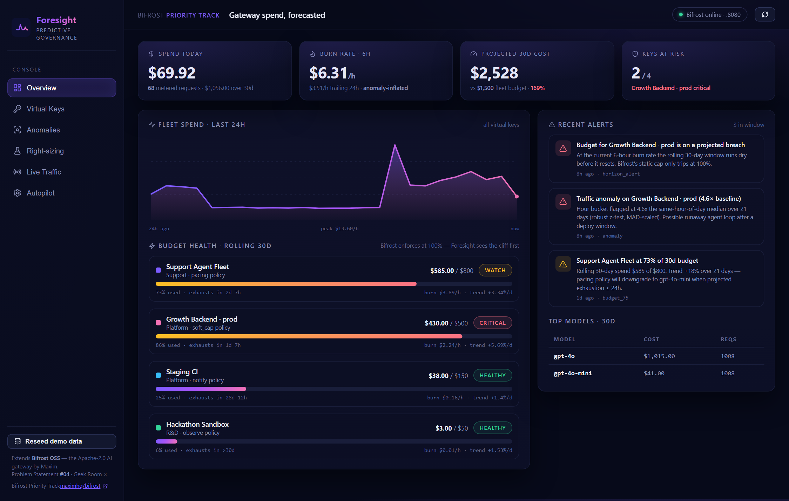
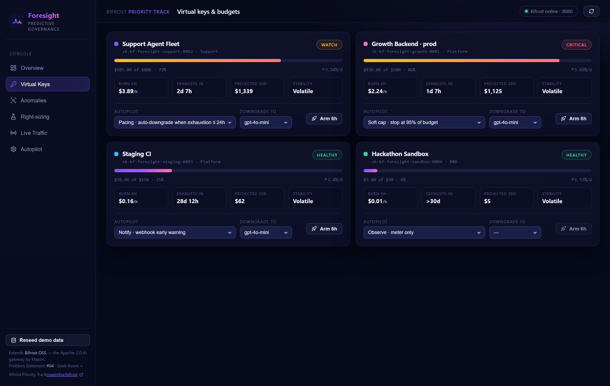
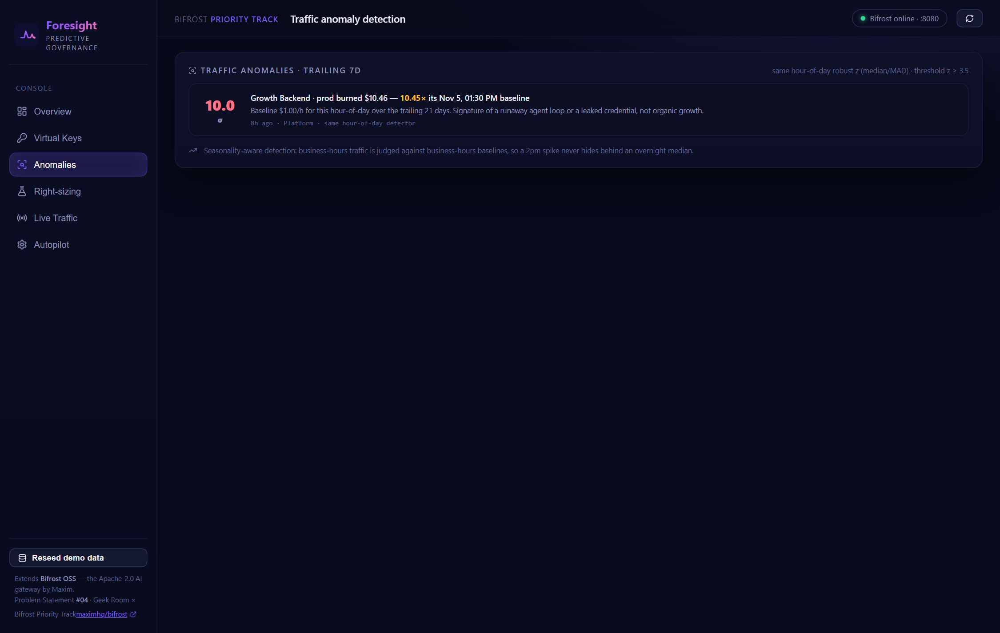
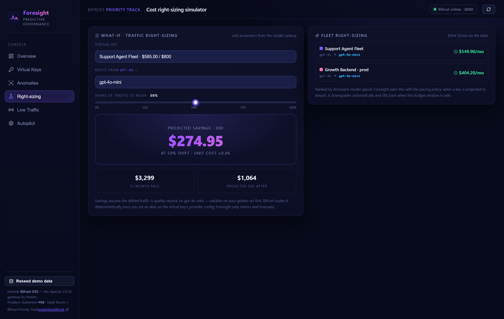

# Bifrost Foresight

> **Problem Statement #04 — "A feature the open-source gateway is missing"**
> Geek Room × Bifrost Priority Track
>
> The missing predictive layer for [Bifrost](https://github.com/maximhq/bifrost), the open-source (Apache-2.0) AI gateway.
> **Bifrost stops your spend at 100% of budget. Foresight stops it hours before — and tells you why.**

  

---

## The gap in the open-source gateway

Bifrost OSS is excellent at **reactive** enforcement: virtual keys, rolling budgets, rate limits, fallbacks, caching. But walk the operator's 3am story and you find no answer:

| Question an operator actually asks | Bifrost OSS | Bifrost Enterprise | **Bifrost Foresight** |
|---|---|---|---|
| "When will this key exhaust its budget?" | ❌ | ❌ | ✅ burn-rate projection per virtual key |
| "Is this 2am traffic spike normal for a Tuesday?" | ❌ | ❌ | ✅ same hour-of-day robust z-score (median/MAD) |
| "Can we get paged *before* the cap trips?" | ❌ | ⚠️ threshold alerts only (reactive) | ✅ horizon alerts + webhook, fires at ≤ N hours to empty |
| "Downgrade this key's model until the window resets?" | ❌ | ❌ | ✅ pacing policy — automatic, time-boxed, self-lifting |
| "What does moving 50% of fleet traffic to a cheaper model save?" | ❌ | ❌ | ✅ right-sizing simulator with unit economics |
| "Show me every token by key, priced." | ⚠️ logs, if wired | ✅ | ✅ metered middleware, works with zero extra config |

Enterprise alerting evaluates `budget_usage_percent >= 80` — a **static threshold sampled after spend accrues**. Nothing in OSS or Enterprise projects the trajectory, detects seasonal outliers, or acts autonomously. That is the feature this project adds, and operators cannot get it anywhere else in the Bifrost stack.

## What it is

**Foresight is a drop-in metering sidecar** for the Bifrost gateway plus an operator console. Your app keeps its existing OpenAI SDK — it just points at Foresight instead of Bifrost:

```
Your app ──► Foresight sidecar ──► Bifrost OSS ──► Providers
             (:8400)                (:8080)        (OpenAI, Anthropic, …)
             meter · forecast        auth, routing,   via your keys or
             · autopilot            fallbacks,        the bundled demo
                                    caches, budgets
```

Three layers, one binary:

1. **Meter** — every request/response passes through two gates: tokens and dollars, attributed per virtual key (from the same `sk-bf-…` token Bifrost itself issued), priced by an embedded model catalog. Zero SDK changes.
2. **Predict** — rolling 30-day budget burn rate per key; projection of exhaustion; same hour-of-day robust anomaly detection across a 21-day window; per-day trend and stability labels.
3. **Prevent** — per-key autopilot policies that act *before* the money is gone:
   - `observe` — meter only
   - `notify` — webhook (Slack-compatible) when projected exhaustion ≤ horizon, and on anomalies
   - `soft_cap` — hard-stop the key at the configured budget fraction (default 95%) — instead of waiting for Bifrost's 100%
   - `pacing` — auto-**downgrade the key's model** to a cheaper drop-in (e.g. `gpt-4o` → `gpt-4o-mini`) when projected exhaustion ≤ 24h; lifts itself after the window

## The demo story

The seeder builds a deterministic 21-day fleet with a pointed narrative:

- **Growth Backend · prod** — inflected upward 8 days ago, burned **86% of its $500 budget**, and spiked **4.6× its 14:00 baseline** 8 hours ago. Foresight projects exhaustion in ~25 hours and flags `critical`. Bifrost sees nothing until 100%.
- **Support Agent Fleet** — 73% of $800, upward drift, pacing armed for `gpt-4o-mini`.
- **Staging CI** — healthy, metered, `notify` armed.
- **Hackathon Sandbox** — dormant, `observe`.

Fire 8 live requests from the console — they flow through the real chain, get metered, priced and attributed in front of you, and page the webhook sink.

## Quickstart

Requirements: **Node ≥ 20**, **Python ≥ 3.11**. No API keys needed — the bundled demo upstream (`acme-llm`) stands in for a self-hosted vLLM endpoint.

```powershell
# 1. Demo upstream — OpenAI-compatible stand-in (port 9100)
cd backend
python -m venv .venv; .\.venv\Scripts\Activate.ps1   # optional
pip install -r requirements.txt
python -m foresight.fakellm                     # terminal 1

# 2. Bifrost OSS gateway with the demo config (port 8080)
npx -y @maximhq/bifrost -app-dir ..\bifrost-config -port 8080   # terminal 2

# 3. Foresight — sidecar + operator console (port 8400)
python main.py                                  # terminal 3
# first boot auto-seeds the 21-day demo fleet; console at http://localhost:8400
```

Or one command (Windows): `.\scripts\run-demo.ps1` — starts everything, waits for health, seeds, opens the console.

Point your own app at the sidecar:

```python
from openai import OpenAI
client = OpenAI(base_url="http://localhost:8400/v1", api_key="sk-bf-foresight-growth-0001")
client.chat.completions.create(model="acme-llm/gpt-4o", messages=[{"role": "user", "content": "hi"}])
```

> The demo uses Bifrost **virtual keys** (`governance.virtual_keys` in `bifrost-config/config.json`, reconciled into its config store at startup). Foresight attributes by the same bearer token and layers prediction on top of Bifrost's own enforcement — the two are complementary, not competing.

## Operator console

| Page | What it shows |
|---|---|
| **Overview** | Fleet spend today, 6h/24h burn rate, 30-day projection, keys-at-risk, 24h spend chart, per-key budget health with exhaustion countdown |
| **Virtual Keys** | Per-key budget bar, burn, projection, trend; edit autopilot policy; arm/release time-boxed model downgrades |
| **Anomalies** | Same hour-of-day robust z-scores across all keys; seasonality-aware so a 2pm spike is judged against 2pms, not midnight medians |
| **Right-sizing** | What-if simulator: shift X% of traffic from one model to another → projected 30d / 12-month savings; fleet-wide recommendations |
| **Live Traffic** | Metered request stream (auto-refresh) + “Fire 8 live requests” to watch tokens land in real time |
| **Autopilot** | Webhook URL, soft-cap fraction, horizon, anomaly z, pacing window; test-fire the webhook; inspect the built-in webhook sink |






## How the forecast works

- **Rolling 30-day windows**, same semantics as Bifrost's `reset_duration` budgets.
- Burn rate reported over 1h/6h/24h; exhaustion ETA uses the **max responsiveness** signal (6h burn, falling back to 24h): `eta = (budget − spent) / burn₆ₕ`.
- Anomaly detection: per key, per hour-of-day slot, robust z via median/MAD over the trailing 21 days — tight enough that business-hour traffic never hides behind overnight baselines.
- Trend: least-squares slope of daily totals per key; stability via coefficient of variation over 14 days.
- Alerting has per-`(key, kind)` cooldowns so a breaching key pages once per window, not once per request.

## API (console + sidecar)

```
POST   /v1/chat/completions          # OpenAI-compatible metering proxy (SSE passthrough)
GET    /v1/models                    # passthrough to Bifrost
GET    /api/health                   # liveness + Bifrost reachability probe
GET    /api/overview                 # KPIs, hourly series, budget health payloads
GET    /api/keys                     # full per-key forecast payloads
PATCH  /api/keys/{vk}                # budget_usd, policy, downgrade_to
POST   /api/keys/{vk}/downgrade      # arm a time-boxed model downgrade
POST   /api/keys/{vk}/release        # release it early
GET    /api/anomalies                # recomputed per request against 21d baseline
GET    /api/alerts                   # audit trail (policy fires, threshold alerts)
POST   /api/simulator                # {vk, from_model, to_model, shift_pct}
GET    /api/recommendations          # fleet right-sizing table
GET    /api/settings | PUT           # webhook URL + thresholds
POST   /api/settings/test-webhook    # fire a test payload
GET    /api/webhook-sink             # inspect what your Slack would receive
POST   /api/seed                     # wipe + reseed the 21-day demo fleet
POST   /api/replay/live              # fire N real requests through the chain
```

## Honest scope notes

- **Demo upstream.** `acme-llm` is a deterministic stand-in so judges can run the whole chain with zero API keys. In production, point `acme-llm`'s config (any OpenAI-compatible endpoint) at your real provider in `bifrost-config/config.json` — nothing else changes.
- **Pricing** is an embedded snapshot (USD per 1M tokens) with a longest-prefix matcher and a conservative default for unknown models. Bifrost itself ingests a live pricing catalog; wiring Foresight to it is a follow-up.
- **Windows.** Bifrost’s dynamic-plugin system needs Linux/macOS `.so` binaries — Foresight is deliberately a sidecar (HTTP/SSE), not a Go plugin: portable everywhere Bifrost runs.
- **Auth.** The demo gateway runs with inference auth (`enforce_auth_on_inference: true`) using seeded `sk-bf-…` virtual keys; the console itself is unauthenticated (hackathon scope) — put it behind SSO/RBAC in prod, like any Bifrost admin surface.
- Seeded data and the alert feed are simulated **context**; all detection, forecasting, enforcement and pricing paths are real code paths executed on live traffic.

## Layout

```
├── bifrost-config/config.json   # Bifrost OSS config: custom provider + VKs + budgets
├── backend/
│   ├── foresight/               # sidecar + console API (FastAPI)
│   │   ├── app.py               # proxy + /api/* + static UI serving
│   │   ├── forecast.py          # burn rate, ETA, trend, status (pure, tested)
│   │   ├── anomaly.py           # same-hour-of-day robust z-scores
│   │   ├── policy.py            # autopilot: notify / soft_cap / pacing
│   │   ├── store.py             # SQLite (WAL) — keys, usage, alerts, sink
│   │   ├── metering.py          # usage extraction + estimate fallback
│   │   ├── pricing.py           # embedded model catalog
│   │   ├── seed.py              # deterministic 21-day demo fleet
│   │   └── fakellm.py           # demo upstream (OpenAI-compatible)
│   └── tests/                   # pytest — engine invariants
├── frontend/                    # React + Vite console (served at :8400)
└── scripts/run-demo.ps1         # one-command demo bring-up
```

## Extending Bifrost upstream

This project is a clean seam for the open-source gateway: prediction does not belong inside the routing hot path, it belongs one hop out, with the same bearer token. The natural contribution to `maximhq/bifrost` would be a first-class `foresight` companion service (or a built-in “forecast” tab in the OSS web UI backed by the same `logs_store` tables), not a fork — Bifrost’s Apache-2.0 license and HTTP contract make that trivial.

---

Built for the **Geek Room AI Global Hackathon** · Bifrost Priority Track · Problem Statement #04
*"Something its operators would miss if you took it away."*
